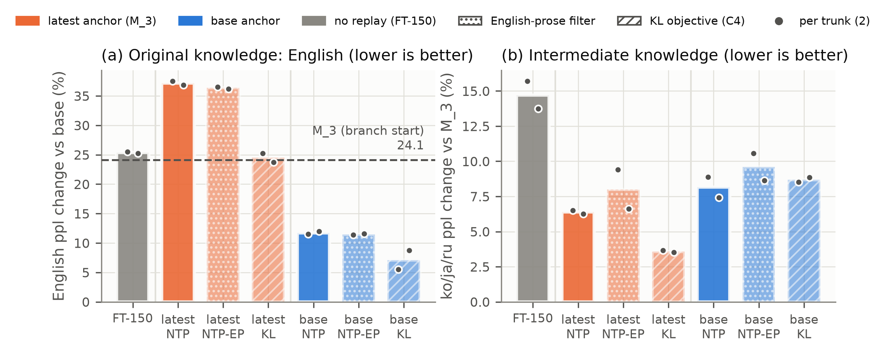

# Which Model Should Remember? Anchor Choice in Self-Generated Replay

Hyunwoo Do (Independent Researcher)

Code, results and paper source for a small study, with decision rules fixed in advance, of **self-generated replay in multi-stage continual pre-training**.
Pythia-410M is trained on Korean → Japanese → Russian Wikipedia and then branches into Greek; the only things varied are
which checkpoint writes the replay text (the *anchor*: the original model, an earlier checkpoint, or the latest one) and the replay
objective (next-token prediction on sampled text vs. token-level KL to the teacher's full distribution). With two trunks per condition,
an original-model anchor retained English much better than the latest anchor and partially recovered English lost earlier; replaying
text sampled from the latest checkpoint with NTP amplified English degradation beyond a no-replay control, and training on the same
text with KL removed the detectable excess. All decision rules were fixed before results (see `LAB_NOTES.md`, chapter 9, in Korean).
These are small-scale results (one 410M model, two trunks per condition); see the paper's limitations section.



*English forgetting (a) and intermediate-language forgetting (b) after learning Greek from the end of cycle 3, by replay anchor and
objective. Bars: mean of two trunks; dots: individual trunks. Hatched bars: KL objective on the same replay text as the NTP bar.*

Repository: https://github.com/DoHyunwooo/replay-anchor-provenance

Paper: `paper/main.pdf` (source `paper/main.tex`, generated from `PAPER_DRAFT.md` by `md2tex.py`).

## Reproduction

Hardware used: one NVIDIA RTX 4060 Ti (8 GB), Windows 11. Peak GPU memory 5.9 GiB (NTP) and 6.2 GiB (KL objective).
Times below are measured wall-clock minutes on that GPU (generation + training + evaluation).

| Step | Command | Paper | Measured time |
|---|---|---|---|
| 0. Language data (ko/ja/ru/el, held-out with contamination rule) | `python build_lang_data.py` | §3.1, §3.3 | a few minutes (streams Wikipedia) |
| 0. English held-out sets (wiki / PG-19 / C4) | `python build_en_heldout.py` (needs `data/en_replay`, see note) | §3.3 | a few minutes |
| 1. B trunks: FT and fresh, seeds 42/43 | `python trunk.py --mode FT --seed 42` (and 43), `python trunk.py --mode fresh --seed 42` (and 43) | §4 (B), §5.1 | FT 29, fresh 197 (generation batch 48; ~70 with batch 24) |
| 1b. Cycle-1 gate | `python cycle_summary.py && python gate_check.py` | §5.1 | < 1 |
| 2. C1 base-anchor trunks | `python trunk.py --mode base --seed 42 --gen_batch 24` (and 43) | §5.1 | 61 |
| 3. C2 branches (2×2 + FT-150) | `python branch.py --trunk trunk_fresh_s42` (and s43) | §5.1, §5.2 | ~107 |
| 4. C4 KL arms | `python branch.py --trunk trunk_fresh_s42 --arms latest_kl base_kl` (and s43) | §5.3 | ~33 |
| 5. C3 anchor age and mix | `python branch.py --trunk trunk_fresh_s42 --arms m1_full m2_full mix` (and s43) | §5.1 | ~67 |
| 6. Pre-specified judgements | `python c_check.py` → `results/cycles/c_check.json` | Table 1 | < 1 |
| 7. KL floor | `python measure_kl_floor.py` → `results/cycles/kl_floor.json` | §6 | ~5 |
| 8. Figures | `python make_figures.py` → `results/figures/` | Fig. 1–4 | < 1 |
| 9. Paper and number check | `python md2tex.py`, then `tectonic paper/main.tex`; `python verify_draft.py --source paper/main.tex` | all | < 5 |

Total on one 8 GB GPU: about 8 hours as run (about 6 hours with generation batch 24 throughout).

Notes:
- Install: `pip install torch==2.5.1 --index-url https://download.pytorch.org/whl/cu121`, then `pip install -r requirements.txt`.
- Every runner resumes where it stopped (generation per batch, training per cycle, evaluation by weight fingerprint).
- Generation seeds are recorded in `data/cycles/replay_seeds.json`; a seed range cannot be reused for a different replay set
  (the C4 arms re-use the C2 replay text by an explicit, recorded exception).
- `data/en_replay` (used only to keep the English Wikipedia held-out disjoint from an earlier replay set) is built by
  `prepare_replay_dataset` in the earlier single-stage script `train.py` (`--replay_data data/en_replay --replay_ratio 0.2`).
  That command goes on to train after saving the cache; stop it once `data/en_replay` exists.
- Not included in this repository: model checkpoints and tokenized data caches (regenerate with the steps above), and results of
  the earlier single-stage phase (`results/fp16`, `results/fp32`), which the paper does not use.
- bf16 training is not bit-reproducible; expect small run-to-run differences. `verify_draft.py` re-derives every number in the
  paper from the result files (some checks read the regenerated replay data).

## Repository layout

- `trunk.py`, `branch.py`: runners (trunks: cycles 1→3; branches from the end of cycle 3).
- `gen_replay.py` (with `gen_selfgen.py`): replay generation; `cycle_train.py`: one cycle of training (NTP or KL replay);
  `eval_cycle.py`: held-out perplexities, probe KL, parameter distance.
- `gate_check.py`, `c_check.py`: pre-specified decision rules; `cycle_summary.py`: retention matrix and cost tables.
- `results/cycles/`: all evaluation files (`eval.csv` per trunk/branch), judgements, costs; `results/figures/`: figures and their data.
- `checkpoints/cycles/**/{run_config.json,train_summary.json,train_log.jsonl}`: training configs and per-step logs (weights excluded).
- `LAB_NOTES.md`: full lab notebook with pre-specified criteria, revisions and observations (Korean).
- Earlier single-stage phase (run01–04): `train.py`, `eval_all.py`, `summarize.py`, `seed_check.py`, `run04_check.py`, and related scripts.

## Pre-release checklist

For the author, before the first push to a public repository:

1. **Git identity.** Set this repository's commit email to your GitHub noreply address (GitHub → Settings → Emails →
   "Keep my email addresses private"; format `<ID>+<username>@users.noreply.github.com`), then check it:
   ```
   git config user.email "<ID>+<username>@users.noreply.github.com"
   python check_git_identity.py
   ```
   The script checks the address the next commit will use and the author and committer addresses of every existing commit
   (all branches and tags). It exits 0 only if all of them are noreply addresses, and masks any other address in its output.
   Also turn on "Block command line pushes that expose my email" on the same GitHub page.
2. **Paper.** `python verify_draft.py --source paper/main.tex --release` and `python verify_draft.py --release` must pass: no internal
   memos ("All summaries: recheck …", "[GitHub URL to be added]", reference status tags) and no incomplete author lists
   ("and others") in `paper/references.bib`.
3. **Files.** `git status --ignored` shows no checkpoints, tokenized data, `internal/` or backup files staged for commit.

## License

MIT, Copyright (c) 2026 Hyunwoo Do (see `LICENSE`).
